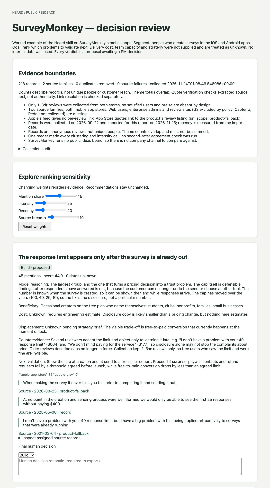

# Heard — a product feedback Claude Skill
A Claude skill that collects **permitted public** product feedback, clusters it into themes, verifies every quote and count in code, and produces a self-contained HTML report with proposed **Build / Watch / Ignore** calls. The PM keeps the final decision.

By [Irene Pylypenko](https://irenepylypenko.com).

## See a real report

**[Open the SurveyMonkey example report →](https://codingyogini.github.io/heard-product-feedback/examples/surveymonkey/report.html)**

It was built from 218 public App Store and Google Play reviews. It has eight themes, each with a proposed Build / Watch / Ignore call, the reasoning and counterevidence behind it, verbatim quotes linked to their sources, and a final decision that stays with a human reviewer. Files and method: [`examples/surveymonkey/`](examples/surveymonkey/).

[](https://codingyogini.github.io/heard-product-feedback/examples/surveymonkey/report.html)

## Install in Claude Code

```
/plugin marketplace add codingyogini/heard-product-feedback
/plugin install heard-product-feedback@irene-pylypenko
```

## Use the skill directly (Claude.ai or other hosts)

Copy `plugins/heard-product-feedback/skills/heard-product-feedback/` into your skills folder, or zip that folder and upload it as a custom skill.

## What it does

1. **Scope & source plan** — confirms product, segment and approved public sources (RSS/Atom, App Store JSON, canonical JSON, manual import). No sign-in walls, no private CRM or support data.
2. **Collect & prepare** — `scripts/heard.py collect` / `prepare` pulls records, strips author fields, dedupes and batches.
3. **Analyze** — the model assigns every record to themes or excludes it with a reason, and proposes a verdict per theme with counterevidence.
4. **Verify & report** — `scripts/heard.py build` checks quote substrings, IDs, coverage and intensity bounds, computes counts and ranking, and renders `report.html`.
5. **Validate** — drafts a bounded spec and falsifiable validation questions for the accepted top theme.

Licensed under MIT. See [PRIVACY.md](PRIVACY.md) for data handling.

Requires Python 3 and file access in the host. Tests: `cd plugins/heard-product-feedback/skills/heard-product-feedback/scripts && python -m unittest test_heard`.

## Layout

```
.claude-plugin/marketplace.json          # marketplace: irene-pylypenko
plugins/heard-product-feedback/
  .claude-plugin/plugin.json
  skills/heard-product-feedback/         # the skill (SKILL.md, scripts, references, assets)
```
